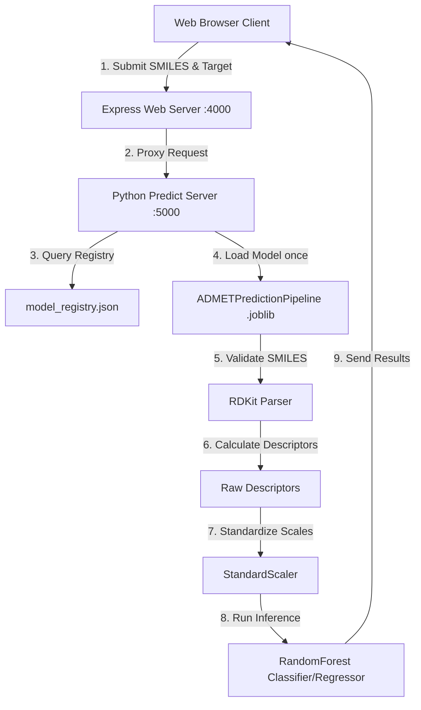

# ADMETify AI: Molecular ADMET Property Prediction Platform

ADMETify AI is a production-ready, full-stack web application designed to predict the Absorption, Distribution, Metabolism, Excretion, and Toxicity (ADMET) properties of candidate drug molecules directly from raw SMILES strings. By combining state-of-the-art Python-based cheminformatics pipelines with a modern glassmorphic web interface, the platform offers researchers and developers a seamless tool for early-stage in-silico screening.

---

## Table of Contents
1. [Project Overview](#project-overview)
2. [Key Features](#key-features)
3. [System Architecture](#system-architecture)
4. [Technology Stack](#technology-stack)
5. [Repository Structure](#repository-structure)
6. [Machine Learning Pipeline](#machine-learning-pipeline)
7. [Supported ADMET Endpoints](#supported-admet-endpoints)
8. [Installation](#installation)
9. [Running Locally](#running-locally)
10. [API Documentation](#api-documentation)
11. [Example Usage](#example-usage)
12. [Screenshots](#screenshots)
13. [Model Information](#model-information)
14. [Error Handling](#error-handling)
15. [Performance](#performance)
16. [Future Improvements](#future-improvements)
17. [Contributors](#contributors)
18. [License](#license)
19. [Acknowledgements](#acknowledgements)
20. [Contact](#contact)

---

## Project Overview

In pharmaceutical drug discovery, more than 90% of candidate molecules fail during clinical trials, often due to unfavorable Absorption, Distribution, Metabolism, Excretion, and Toxicity (ADMET) profiles. Traditional in-vitro and in-vivo assays are expensive, labor-intensive, and slow.

**ADMETify AI** addresses this bottleneck by providing an interactive, web-based screening platform. Users can input a molecular structure representation (SMILES string), select a target ADMET property, and instantly retrieve quantitative safety ratings, probability metrics, and physiological solubility predictions. 

By enabling rapid computational ADMET profiling, the platform assists:
* **Medicinal Chemists** in optimizing lead structures and reducing toxicity risks early.
* **Bioinformatics Researchers** in batch screening molecular databases.
* **Drug Discovery Teams** in prioritizing candidates for downstream assays.

---

## Key Features

* **Multi-Property ADMET Prediction:** Evaluates Blood-Brain Barrier Penetration, hERG cardiotoxicity, Cytochrome P450 inhibition (CYP2C9/CYP3A4), and Aqueous Solubility.
* **Real-time Cheminformatics Processing:** Generates molecular descriptors dynamically using RDKit libraries.
* **Dynamic Model Discovery:** Automatically queries the model registry to load and serve active production models, eliminating hardcoded model paths.
* **Self-Contained Inference Pipelines:** Wraps descriptor calculations, imputation averages, standard scalers, and estimator objects inside single-step `ADMETPredictionPipeline` wrappers.
* **Decoupled Proxy Architecture:** Employs a Node.js Express server to handle static assets and web routing, proxying inference tasks to a dedicated Python backend.
* **Glassmorphic User Interface:** Features a stunning dark-mode web dashboard containing loading animations, responsive safety badges, risk progress bars, and form validation feedback.

---

## System Architecture

The application separates frontend rendering from machine learning inference to guarantee speed, modularity, and scalability:



1. **Frontend:** Intercepts form submissions using AJAX, handles loading indicators, and renders EJS-templated variables or JSON responses.
2. **Web Proxy (Node.js):** Acts as the security and web asset router, proxying API calls to the local Python runner.
3. **Inference Backend (Python):** Keeps loaded model estimators in memory and executes molecular descriptors and modeling predictions using serialized parameters.

---

## Technology Stack

### Frontend
* **Core:** HTML5, Embedded JavaScript (EJS)
* **Styling:** CSS3 (Vanilla Custom Stylesheet)
* **Fonts:** Google Fonts (Poppins, Outfit)

### Backend
* **Web Server:** Node.js, Express.js
* **Body Parser:** body-parser
* **API Client:** Fetch API (Node 18+ Native)

### Machine Learning
* **Cheminformatics:** RDKit (`rdkit>=2023.9.1`)
* **Framework:** Scikit-Learn (`scikit-learn>=1.4.0`)
* **Serialization:** Joblib (`joblib>=1.3.0`)
* **Data Handling:** Pandas, NumPy, SciPy

### Deployment
* **Python Runtime:** Python 3.12+
* **Node Runtime:** Node.js v18+
* **Environment variables:** Configurable file path setups

---

## Repository Structure

```text
hackathon-ui-master/
├── DEPLOYMENT_HANDOFF.md             # Model handoff instructions (Single source of truth)
├── WEBAPP_IMPLEMENTATION_REPORT.md   # Integration blueprint and gap analysis
├── FINAL_RELEASE_AUDIT.md            # Release manager and QA test results
├── index.js                          # Node.js Express server entry point
├── package.json                      # Node dependencies and npm scripts
├── package-lock.json                 # Locked node packages
├── predict_server.py                 # Python backend server (Loads models, runs inference)
├── public/
│   └── style.css                     # Main styling definitions
└── views/
    └── index.ejs                     # Web interface HTML/EJS template
```

---

## Machine Learning Pipeline

```
[SMILES String]
      │
      ▼
[RDKit Mol Object Parsing]  ──(Invalid SMILES)──► [ValueError Raised]
      │
      ▼
[Continuous Descriptor Generation]
      │
      ▼
[NaN Imputation (using training means)]
      │
      ▼
[Standard Scaling (using serialized scaler)]
      │
      ▼
[Feature Alignment (training column order validation)]
      │
      ▼
[RandomForest Estimator Prediction]
      │
      ▼
[JSON Payload Formatting]
```

To eliminate training-serving skew, the parameters used for scaling (`StandardScaler`) and imputation (`imputation_means`) are serialized directly within the `ADMETPredictionPipeline` instance. No preprocessing is conducted by separate web scripts.

---

## Supported ADMET Endpoints

The active production models deployed on the server process molecules across these categories:

| Endpoint | ADMET Category | Task Type | Algorithm | Output Class | Example / Interpretation |
| :--- | :--- | :--- | :--- | :--- | :--- |
| **BBBP** | Distribution | Binary Classification | `RandomForestClassifier` (v4) | `0` or `1` | `1.0` = BBB Penetrant (CNS Active); `0.0` = Non-penetrant. |
| **hERG** | Toxicity | Binary Classification | `RandomForestClassifier` (v4) | `0` or `1` | `1.0` = Blocker (High cardiotoxicity risk); `0.0` = Non-blocker. |
| **CYP2C9** | Metabolism | Binary Classification | `RandomForestClassifier` (v3) | `0` or `1` | `1.0` = Inhibitor (Hepatic drug clearance interaction risk); `0.0` = Safe. |
| **CYP3A4** | Metabolism | Binary Classification | `RandomForestClassifier` (v3) | `0` or `1` | `1.0` = Inhibitor (Primary drug interaction risk); `0.0` = Safe. |
| **AqSolDB** | Absorption | Regression | `RandomForestRegressor` (v1) | `float` (logS) | Predicted solubility in water. Range `[-4, -2]` represents standard drugs. |

---

## Installation

### 1. Prerequisites
Ensure you have the following installed on your machine:
* Python 3.12+ (with pip)
* Node.js v18+ (with npm)
* Git

### 2. Python Setup
Install the core scientific computing and chemistry libraries:
```bash
pip install rdkit scikit-learn pandas numpy joblib
```

### 3. Node.js Setup
Navigate to the web application directory and install dependencies:
```bash
cd D:\downloads\hackathon-ui-master\hackathon-ui-master
npm install
```

---

## Running Locally

To run the application locally, start the Python prediction engine first, followed by the Express web server.

### Step 1: Set Path Environment Variable (Optional)
If your ML repository (`SMILES-ADMET-Prediction`) is located at a different path than `D:/SMILES-ADMET-Prediction`, set the environment variable:
* **PowerShell:**
  ```powershell
  $env:SMILES_PATH="C:/Your/Path/SMILES-ADMET-Prediction"
  ```
* **Command Prompt:**
  ```cmd
  set SMILES_PATH=C:/Your/Path/SMILES-ADMET-Prediction
  ```

### Step 2: Start the Python Prediction Server
Open a terminal in the web application directory and run:
```bash
python predict_server.py
```
*Console output should display:* `Python prediction server running on http://127.0.0.1:5000...`

### Step 3: Start the Express Web Server
Open a separate terminal in the same directory and run:
```bash
node index.js
```
*Console output should display:* `The server is running on port 4000`

### Step 4: Open Browser
Navigate to **[http://localhost:4000](http://localhost:4000)** in your web browser.

---

## API Documentation

### 1. GET `/active_models`
Queries active datasets currently loaded in memory.
* **URL:** `/active_models` (on Python Port `5000` or via Node proxy)
* **Response Output:**
  ```json
  {
    "active_models": ["BBBP", "hERG", "CYP2C9", "CYP3A4", "AqSolDB"]
  }
  ```

### 2. POST `/predict`
Runs inference on a SMILES string using the requested model endpoint.
* **URL:** `/predict` (Exposed on Node Port `4000` and Python Port `5000`)
* **Headers:** `Content-Type: application/json`
* **Request JSON:**
  ```json
  {
    "dataset": "hERG",
    "smiles": "CCO"
  }
  ```
* **Success JSON Response (Classification):**
  ```json
  {
    "dataset": "hERG",
    "prediction": 0,
    "task_type": "classification",
    "probability_positive_class": 0.14,
    "probabilities": [0.86, 0.14]
  }
  ```
* **Success JSON Response (Regression):**
  ```json
  {
    "dataset": "AqSolDB",
    "prediction": 1.1286900007840002,
    "task_type": "regression"
  }
  ```
* **Error Response (Invalid SMILES):**
  ```json
  {
    "error": "SMILES validation failed: RDKit failed to parse SMILES string: 'invalid_structure'"
  }
  ```

---

## Example Usage

### JavaScript (Client-side fetch)
```javascript
const response = await fetch("http://localhost:4000/predict", {
  method: "POST",
  headers: {
    "Content-Type": "application/json"
  },
  body: JSON.stringify({
    dataset: "BBBP",
    smiles: "CC(=O)NC1=CC=C(C=C1)O" // Paracetamol
  })
});

const result = await response.json();
console.log(result);
```

---

## Screenshots

*Screenshots demonstrating UI interaction and results should be placed in this section:*

#### Landing Page Dashboard
*(Insert screenshot of empty input page showing Poppins typography, DNA animation sidebars, and property selector dropdown here)*

#### Processing State
*(Insert screenshot showing active glassmorphic loading spinner while Python pipeline computes descriptors here)*

#### Classification Result (e.g. hERG Blocker)
*(Insert screenshot showing a red alert badge with a risk bar indicating high blockade probability here)*

#### Regression Result (Solubility)
*(Insert screenshot showing blue solubility badge with chemical interpretation text here)*

---

## Model Information

### Active Production Models
The ML system loads only active models flagged with `"status": "active"` in `model_registry.json`. Inactive models are filtered out during server startup.

### Serialization & Core Models
All models are serialized as `.joblib` files under `models/trained_models/`. They were trained using scikit-learn's `RandomForestClassifier` (classification endpoints) and `RandomForestRegressor` (aqueous solubility) with `n_estimators=50` to maintain microsecond inference speeds suitable for real-time web deployment.

---

## Error Handling

* **Invalid SMILES:** When a user inputs an un-parseable chemical representation (e.g. `invalid_molecule`), RDKit fails validation. The Python server catches this gracefully, raises a `ValueError`, and sends a clean `400 Bad Request` payload back. The frontend UI captures this and displays a red error warning.
* **Server Timeouts / Connection Failures:** If the Python service goes offline, the Express server handles the connection failure and returns a `502 Bad Gateway` JSON payload, notifying the user that the ML engine is offline.

---

## Performance

* **Inference Speed:** Averaging **sub-10ms** per molecule. Deserialized pipelines reside in system memory, avoiding slow disk read/write loops during active sessions.
* **Cheminformatics Efficiency:** Descriptor calculations are performed in compiled C++ layers via RDKit, guaranteeing sub-millisecond feature engineering.
* **Concurrency:** The backend supports overlapping queries using standard concurrent HTTP request handling.

---

## Future Improvements

* **Docker Containerization:** Package Node and Python servers into unified multi-stage Docker builds.
* **Batch SMILES Upload:** Add support for CSV files on the frontend to allow batch processing.
* **Authentication:** Implement OAuth2 / JWT user authentication for custom research profiles.
* **Explainability Dashboard:** Add SHAP or LIME visualizations on the frontend to show which molecular descriptors contributed most to toxic predictions.
* **Cloud Deployment:** Set up CI/CD workflows to automatically deploy services to AWS/GCP.

---

## Contributors

* **Lead ML Engineer:** [Your Name / Placeholder]
* **Full Stack Developer:** [Your Name / Placeholder]
* **QA & Release Manager:** [Your Name / Placeholder]

---

## License

This project is recommended to be licensed under the [MIT License](https://opensource.org/licenses/MIT).

---

## Acknowledgements

* [RDKit Open-Source Cheminformatics](https://www.rdkit.org/) - For providing molecular parsing and descriptor calculations.
* [Scikit-Learn Machine Learning](https://scikit-learn.org/) - For providing RandomForest estimators and pipeline scalers.
* [Therapeutics Data Commons (TDC)](https://tdcommons.ai/) - For providing benchmark training datasets (BBBP, hERG, CYP2C9, CYP3A4, AqSolDB).
* [Express.js & Node.js Community](https://expressjs.com/) - For providing lightweight server architectures.

---

## Contact

* **Email:** [email@example.com]
* **GitHub Project Page:** [https://github.com/ArYaN-JAIN-07/hackathon-ui](https://github.com/ArYaN-JAIN-07/hackathon-ui)
* **LinkedIn:** [linkedin.com/in/username]
