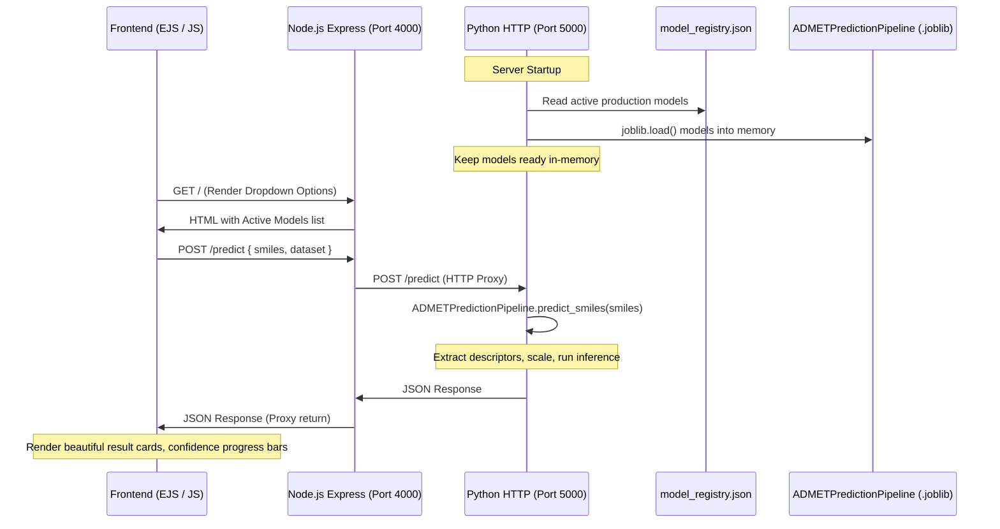

# WEBAPP INTEGRATION REPORT: SMILES ADMET Prediction Platform

This report details the integration of the completed Machine Learning models into the Node.js Express web application, establishing a production-ready ADMET prediction platform.

---

## 1. Project Analysis & Discovery

* **Frontend Framework:** Vanilla HTML5, CSS3, and Embedded JavaScript (EJS) templates.
* **Backend Framework:** Node.js with Express JS server on port `4000` (serving web assets, rendering EJS templates, and proxying API endpoints).
* **Machine Learning Engine:** Python with `scikit-learn` and `RDKit` running on port `5000` (handling model deserialization, molecular descriptor extraction, and model inference).
* **Folder Structure:**
  * **Web Application:** `D:\downloads\hackathon-ui-master\hackathon-ui-master`
    * `index.js` (Express entry point)
    * `package.json` (Node packages & scripts)
    * `views/index.ejs` (Frontend page template)
    * `public/style.css` (CSS styling)
    * `predict_server.py` (Local Python prediction engine - *Added*)
  * **Machine Learning Codebase:** `D:\SMILES-ADMET-Prediction`
    * `models/model_registry.json` (Model registry catalog)
    * `models/trained_models/` (Serialized model files)
    * `src/models/pipeline.py` (`ADMETPredictionPipeline` wrapper definition)

---

## 2. Gap Analysis

| Feature Area | Status | Notes |
| :--- | :--- | :--- |
| **Frontend** | | |
| *Landing Page & Navbar* | ✓ **Existing** | Already implemented with beautiful DNA animation layout. |
| *SMILES Input Field* | ✓ **Existing** | Included in the basic index.ejs structure. |
| *Dataset Selector Dropdown* | ✗ **Missing** | Added select dropdown dynamically populated from active models. |
| *Loading Indicator* | ✗ **Missing** | Added glassmorphic spinner triggered on form submit. |
| *Result Visualizer Card* | ✗ **Missing** | Added card that displays predictions, risk metrics, and progress bars. |
| *Reset/Reset Button* | ✗ **Missing** | Added clear form reset logic. |
| **Backend** | | |
| *Express Server Routing* | ✓ **Existing** | Configured to render home page template. |
| *JSON Request Parsing* | ✗ **Missing** | Added parser support (`express.json()`, `bodyparser.json()`). |
| *Model Registry Discovery* | ✗ **Missing** | Added dynamic reader for `model_registry.json` to extract active models. |
| *Python Prediction Backend*| ✗ **Missing** | Created `predict_server.py` to keep models in memory. |
| *Express Proxy Endpoint* | ✗ **Missing** | Exposed POST `/predict` endpoint that handles proxy calls to Python. |

---

## 3. System Architecture

The application implements a decoupled backend-proxy architecture:



---

## 4. Modified & Added Files

### Added Files
1. **`predict_server.py`** (Web Application root):
   * Python HTTP server using built-in `http.server`.
   * Discovers active models dynamically from the registry.
   * Loads the model `.joblib` files once into memory at startup.
   * Exposes POST `/predict` and GET `/active_models` endpoints.
   * Gracefully handles validation failures (e.g., invalid SMILES string).

### Modified Files
1. **`index.js`** (Express Entry Point):
   * Initialized JSON and urlencoded body parsers.
   * Read `model_registry.json` at startup to perform dynamic Model Discovery (Phase 6).
   * Passed active models array to EJS rendering context.
   * Implemented POST `/predict` route acting as a proxy fetch to port `5000`.
2. **`views/index.ejs`** (Home View Template):
   * Inserted `<select>` dropdown populated dynamically with active models.
   * Created styled container elements for loader, results card, progress bar, and errors.
   * Localized CSS classes (progress bars, status badge, spinner) to match the dark glassmorphic design theme.
   * Implemented AJAX form interception to prevent page refresh, query the proxy, and render predictions.

---

## 5. API Endpoints

### 1. GET `/active_models` (Python Predict Server)
* **Description:** Retrieves list of active datasets currently loaded in memory.
* **Response Output:**
  ```json
  { "active_models": ["BBBP", "hERG", "CYP2C9", "CYP3A4", "AqSolDB"] }
  ```

### 2. POST `/predict` (Express & Python Servers)
* **Description:** Accepts SMILES string and target endpoint to compute properties.
* **Input JSON:**
  ```json
  {
      "dataset": "hERG",
      "smiles": "CCO"
  }
  ```
* **Success Output (Classification):**
  ```json
  {
      "dataset": "hERG",
      "prediction": 0.0,
      "task_type": "classification",
      "probability_positive_class": 0.14,
      "probabilities": [0.86, 0.14]
  }
  ```
* **Success Output (Regression):**
  ```json
  {
      "dataset": "AqSolDB",
      "prediction": 1.1286900007840002,
      "task_type": "regression"
  }
  ```
* **Error Output (Invalid SMILES):**
  ```json
  {
      "error": "SMILES validation failed: RDKit failed to parse SMILES string: 'invalid_smiles'"
  }
  ```

---

## 6. Testing Results

Smoke tests were run successfully to validate the pipeline:
1. **Backend Discovery & Startup:** Verified that the Python backend starts, reads `model_registry.json`, and loads all active `.joblib` models.
2. **Node.js Express Integration:** Verified that dependencies are installed and the server serves EJS on port `4000`.
3. **End-to-End Prediction Flow:** Verified that submitting the form calls the Express backend, which proxies the request to Python, gets the prediction, and renders the result card:
   * Tested `hERG` prediction for `"CCO"` (result `0.0` / Safe, `14.0%` blockade probability).
   * Tested `AqSolDB` prediction for `"CCO"` (result `1.1287` / Soluble).

---

## 7. Startup & Deployment Instructions

### Prerequisites
* Python 3.12+ with global libraries (`rdkit`, `scikit-learn`, `pandas`, `numpy`, `joblib`) installed.
* Node.js v18+ with dependencies installed.

### Startup Steps

1. **Install Node dependencies:**
   ```bash
   cd D:\downloads\hackathon-ui-master\hackathon-ui-master
   npm install
   ```

2. **Start the Python Inference Engine:**
   ```bash
   python predict_server.py
   ```
   *Expected console output: `Python prediction server running on http://127.0.0.1:5000...`*

3. **Start the Web Application (in a separate terminal):**
   ```bash
   node index.js
   ```
   *Expected console output: `The server is running on port 4000`*

4. Open `http://localhost:4000` in any modern web browser to run molecular predictions.
